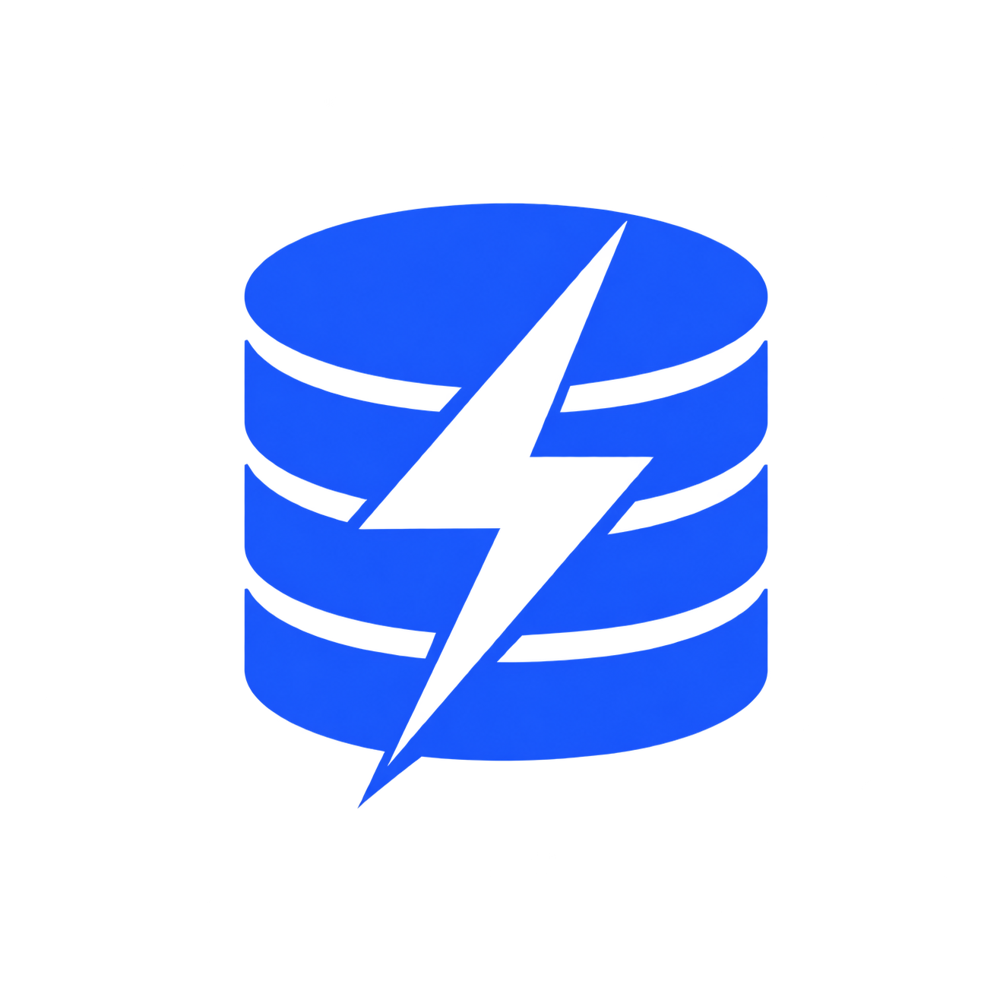

<div align="center">



# DBolt

**Agentic cross-platform SQL database GUI client — your database agent for 70+ databases.**

**100% Free & Open Source · Privacy-First · Bring Your Own AI Key or Run Locally**

[](LICENSE)


</div>

---

**DBolt** is a high-performance, open-source database client powered by **Tauri v2 (Rust)** and **Vue 3 + TypeScript**. Built as a native alternative to heavyweight Electron/Java clients like DBeaver, Navicat, and DataGrip.

All features — including the AI Assistant, Visual ER Diagram, Cross-Engine Data Migration, SSH Tunneling, and Model Context Protocol (MCP) Bridge — are **100% free and permanently unlocked**.

---

## ✨ Features

* **🤖 Agentic Data Studio (AI Assistant)**:
  * Natural language to SQL with schema-aware context.
  * SQL optimization, query explanation, and automatic error diagnosing.
  * Supports **OpenAI, Anthropic, Gemini, DeepSeek, Ollama, LM Studio**, and **Custom OpenAI/Anthropic Compatible Endpoints**.
* **⚡ Native Performance & Lightweight**:
  * Built with Rust & Tauri v2 — no Chromium overhead, no Java runtime needed.
  * Fast startup and minimal memory footprint.
* **🌐 70+ Databases Supported**:
  * PostgreSQL, MySQL, SQLite, SQL Server, ClickHouse, DuckDB, Oracle, MariaDB, Snowflake, CockroachDB, and many more.
* **🗺️ Visual ER Diagram Generator**:
  * Interactive entity-relationship diagrams generated directly from your database schemas.
* **🔄 Cross-Engine Data Transfer**:
  * Move tables and datasets between different database engines with automatic type mapping.
* **🔒 Secure Connectivity**:
  * Multi-hop SSH Tunneling, SSL/TLS encryption, and OS keychain credential storage.
* **🔌 Model Context Protocol (MCP) Bridge**:
  * Built-in MCP Server allowing Claude Desktop, Cursor, and agent stacks to connect to your databases safely.

---

## 🚀 Getting Started

### Prerequisites

* [Node.js](https://nodejs.org/) `>= 18`
* [Rust](https://rustup.rs/) (edition 2021)
* **Windows**: [Microsoft C++ Build Tools](https://visualstudio.microsoft.com/visual-cpp-build-tools/)
* **macOS**: `xcode-select --install`
* **Linux**: `libgtk-3-dev`, `libwebkit2gtk-4.1-dev`, `libssl-dev`

### Development

```bash
# 1. Install frontend dependencies
npm install

# 2. Run Vite frontend in browser
npm run dev

# 3. Run full native desktop app
npm run tauri dev
```

### Build & Package

```bash
# Build desktop installer / executable
npm run tauri build
```

---

## 📜 License

Licensed under the [Apache License, Version 2.0](LICENSE).
Copyright © DBolt Contributors.
